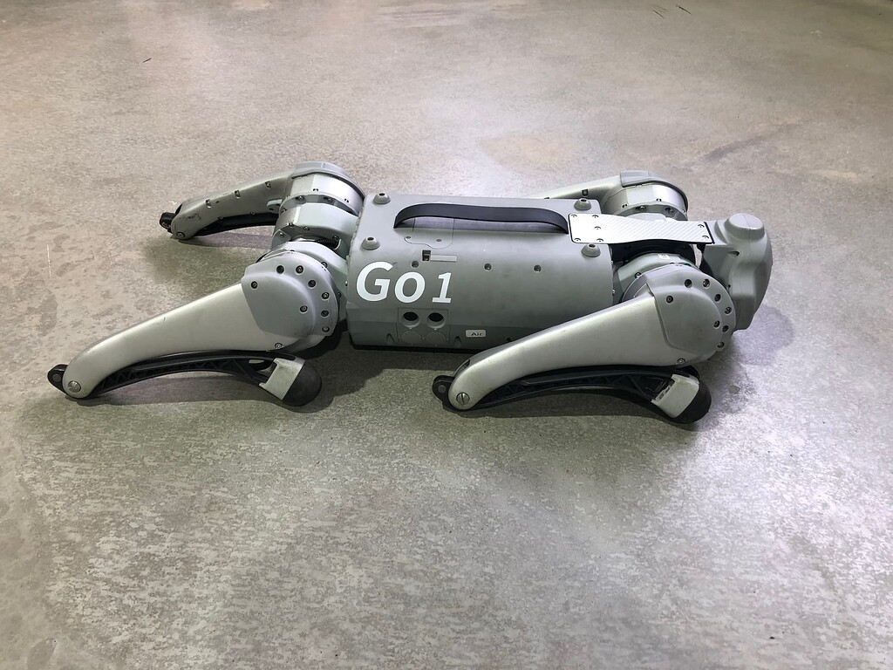

# Unitree Go1 Depth Perception

**Stereo depth visualization and a center-point obstacle indicator in C++**, developed by Koroush Mobasserazad for a scientific project at WHZ in summer semester 2026.

The coursework extends the Unitree camera example with raw-depth inspection, distance reporting, and a color-mapped depth display. This repository preserves that work and adds a separately identified portfolio revision with explicit configuration, configurable depth scaling, and invalid-measurement handling.



**Scope:** a perception demonstrator. It does not send movement commands, stop the robot, plan paths, or establish that an entire path is clear. The revised camera application still requires a build and validation on compatible Linux/Go1 hardware; only the portable decision logic has been tested locally.

## My coursework contribution

Compared with the supplied UnitreeCameraSDK `example_getDepthFrame.cc`, the coursework:

- Requests non-colorized depth frames through `getDepthFrame(depth, false, timestamp)`.
- Inspects the OpenCV data type and reads the center pixel for float depth frames.
- Reports an obstacle for positive center-depth values below a one-meter threshold, assuming float values are meters.
- Adds clipped 8-bit conversion and JET color visualization for float and unsigned 16-bit input.
- Changes stereo configuration parameters for the experiment.

The upstream SDK supplies camera access and stereo computation. Those components are not presented as original work. See [provenance and changes](PROJECT_NOTES.md) and [upstream attribution](THIRD_PARTY.md).

## Portfolio revision

`depth_monitor.cpp` retains the same center-point concept and adds:

- An explicit configuration-file argument, resolving the original filename mismatch.
- A required meters-per-unit scale instead of inferring physical units from storage type.
- Three outcomes: `OBSTACLE AT CENTER`, `CENTER BEYOND THRESHOLD`, and `UNKNOWN DEPTH`.
- Invalid/out-of-range measurements displayed in black; zero, NaN, infinity, and tiny values are never described as a clear path.
- Keyboard handling during missing-frame periods, a five-second frame timeout, signal handling, and cleanup on ordinary exceptions.
- A center crosshair, state overlay, and console output limited to approximately once per second.
- Portable tests for classification, unit conversion, and numeric argument validation.

The 0.2–4.0 m interval is an application acceptance/display range, **not a verified sensor accuracy specification**. A measurement at the obstacle threshold is classified as beyond the threshold, matching the original strict comparison.

## Files

This small CMake project keeps its source and configuration files at the repository root so both the current monitor and the preserved coursework are easy to inspect.

| File | Purpose |
| --- | --- |
| `depth_monitor.cpp` | Revised camera application |
| `depth_policy.hpp` | Hardware-independent validation and classification |
| `test_depth_policy.cpp` | Portable regression checks |
| `CMakeLists.txt` | Linux camera target and portable test target |
| `example_Koroush_Depthframe.cc` | Original coursework, preserved byte-for-byte; not built by default |
| `Stero_config_Koroush.yaml` | Original custom configuration, including its original filename |
| `stereo_camera_config.yaml` | Baseline configuration supplied alongside the coursework |
| `PROJECT_NOTES.md` | Contribution comparison, review, and validation record |
| `THIRD_PARTY.md`, `LICENSE` | Upstream attribution and MPL-2.0 text |

## Build

### Requirements for the camera application

- Linux on x86-64 or AArch64, with a compatible Unitree stereo camera and camera access configured.
- C++14 compiler and CMake 3.18 or newer.
- UnitreeCameraSDK v1.1.0 headers and matching prebuilt static libraries for the target architecture.
- OpenCV 4 development files with GUI support and the GStreamer support requested by the SDK, plus libudev development files and pthread support.

Obtain the SDK separately from [Unitree Robotics](https://github.com/unitreerobotics/UnitreecameraSDK). SDK binaries and unrelated robot-motion examples are not bundled here. The CMake target follows the library dependencies in the supplied SDK; ABI compatibility with the target's OpenCV/compiler must be checked on that machine.

From this repository's root:

```bash
cmake -S . -B build -DUNITREE_CAMERA_SDK=/absolute/path/to/UnitreecameraSDK
cmake --build build --parallel
ctest --test-dir build --output-on-failure
```

The project builds only the depth monitor, so the separate upstream point-cloud viewer and its OpenGL/GLUT dependencies are not needed by this target.

### Portable checks without a robot or SDK

```bash
cmake -S . -B build-tests -DBUILD_CAMERA_APP=OFF
cmake --build build-tests --config Release
ctest --test-dir build-tests -C Release --output-on-failure
```

These tests validate decision logic; they do not validate stereo depth, camera capture, OpenCV rendering, or physical obstacle detection.

## Run on the camera host

```text
depth_monitor CONFIG METERS_PER_UNIT [THRESHOLD_M]
```

Run from the repository root, with the correct camera configuration. For example, **only after confirming that raw depth values are in meters**:

```bash
./build/depth_monitor Stero_config_Koroush.yaml 1.0 1.0
```

If measurements are confirmed to be millimeters, use `0.001` as the scale instead. The SDK header describes the color flag but does not establish a physical-unit contract. The supplied historical console screenshot contains zero and implausibly small values; it is not evidence that metric distances are calibrated. Check several known distances and invalid regions before interpreting thresholds.

The camera GUI requires a display session. Press **Esc** in the image window or **Ctrl+C** in the terminal to exit. A failed frame read replaces the prior image with an unknown-depth status. The five-second timeout is checked between SDK calls; it cannot interrupt a blocking SDK call.

## Configuration comparison

| Parameter | Supplied baseline | Custom coursework |
| --- | --- | --- |
| `Threshold` | 190 | 4000 |
| `RectifyFrameSize` | 232 × 200 | 464 × 400 |
| `FrameSize` | 928 × 400 | 928 × 400 |
| `DeviceNode` | 1 | 1 |
| `FrameRate` | 30 | 30 |

The SDK's `Threshold` parameter is separate from the application's obstacle threshold. Its physical meaning is not established by the inspected header and must not be interpreted as a four-meter obstacle limit. Both YAML files retain the upstream `Reserved` placeholder. Their SDK runtime behavior remains to be checked on hardware.

The original `.cc` always opens `stereo_camera_config.yaml`; the revised monitor uses the path you supply, making the custom configuration selectable without renaming files.

## Limitations and next steps

A single center pixel can miss obstacles elsewhere in the image and can fluctuate on low-texture or reflective surfaces. The prototype has no spatial filtering, temporal filtering, confidence map, camera calibration validation, or measured detection accuracy. Future work includes a region-of-interest statistic with validity coverage, calibrated distance tests, timestamp freshness checks, and an independently designed motion-control interface.

## Attribution

Based on [UnitreeCameraSDK](https://github.com/unitreerobotics/UnitreecameraSDK), whose supplied distribution is labeled v1.1.0 and includes MPL-2.0. See [THIRD_PARTY.md](THIRD_PARTY.md) for the original example author and copyright notice. The SDK-derived code is distributed with the upstream license text; the project photograph is not covered by the software license. No affiliation or endorsement by Unitree is implied.
